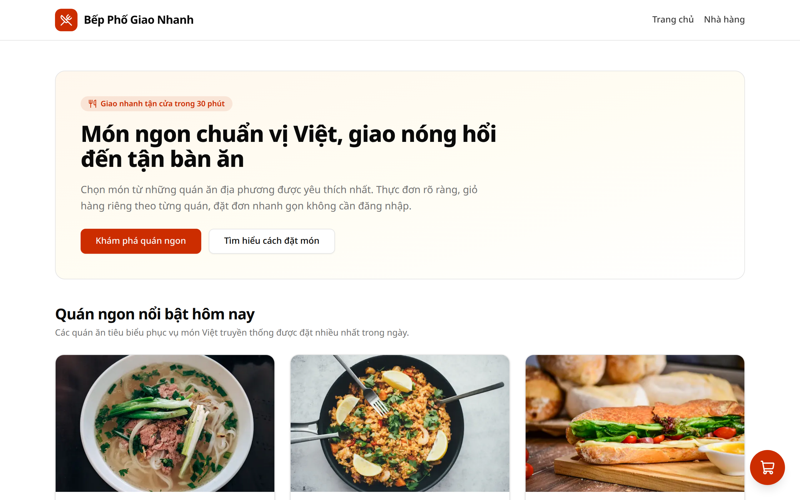
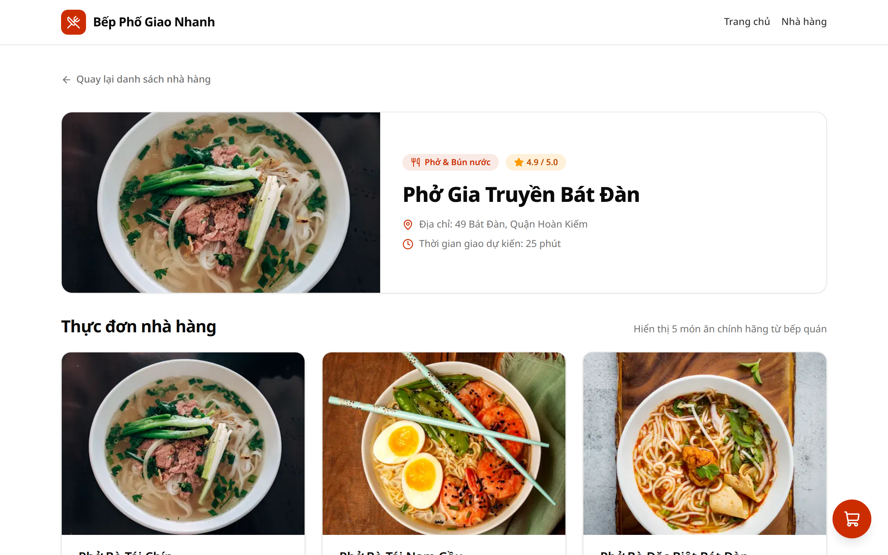
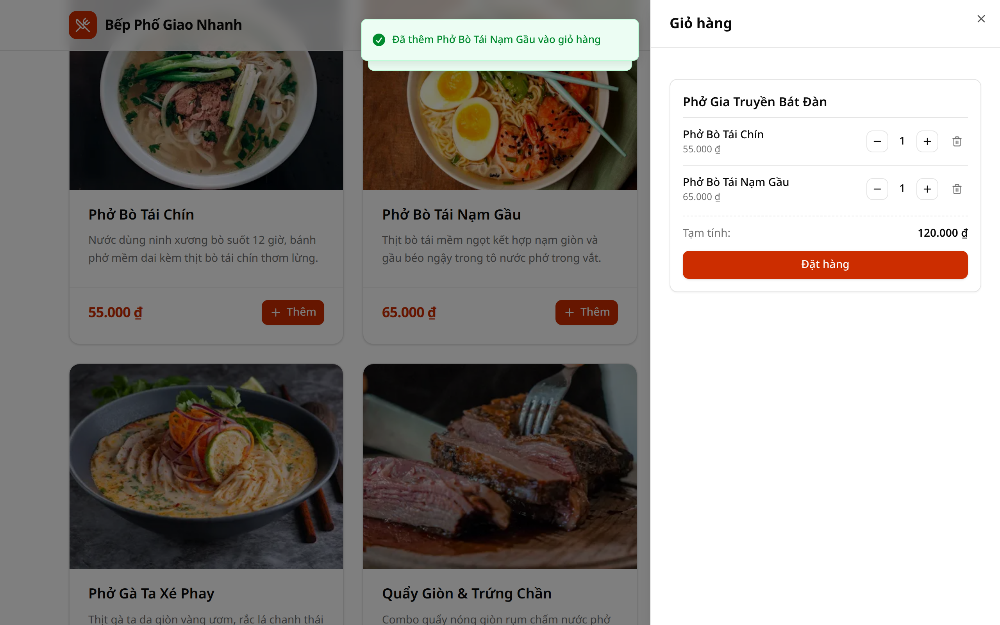
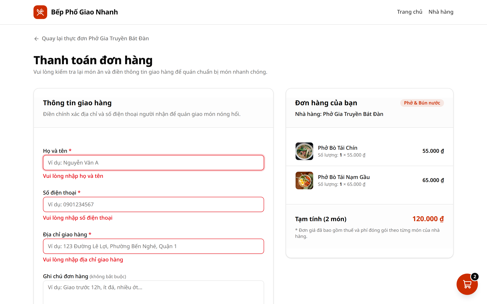
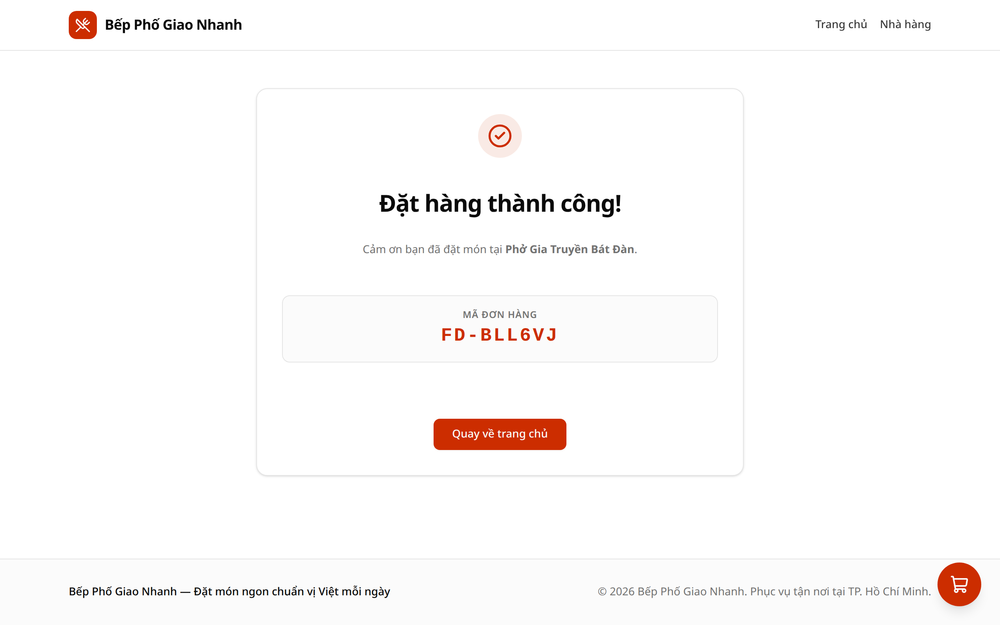

# WDS Food Delivery

Ứng dụng web đặt đồ ăn trực tuyến (Food Delivery) được xây dựng theo kiến trúc Monorepo hiện đại với Next.js 16 (App Router), React 19, TypeScript, Tailwind CSS v4, shadcn/ui, Zustand persist store, React Hook Form + Zod, MSW (Mock Service Worker), Vitest và Playwright e2e testing.

Dự án mô phỏng trải nghiệm người dùng hoàn chỉnh từ duyệt danh sách quán ăn, xem thực đơn chi tiết, quản lý giỏ hàng độc lập theo từng nhà hàng (per-restaurant cart), kiểm tra hợp lệ thông tin giao hàng đến gửi đơn và nhận mã đơn hàng xác nhận.

---

## 📸 Giao diện ứng dụng (Screenshots)

### 1. Trang chủ (Home Page)
Duyệt danh sách các nhà hàng đặc sắc với ẩm thực phong phú, đánh giá và thời gian giao dự kiến.



### 2. Trang chi tiết nhà hàng (Restaurant Menu)
Hiển thị thông tin quán ăn kèm danh sách các món đặc trưng có hình ảnh, giá bán định dạng VND chuẩn và nút thêm món.



### 3. Giỏ hàng theo từng nhà hàng (Cart Drawer)
Cart Drawer trực quan hiển thị từng phần giỏ hàng độc lập cho từng nhà hàng, cho phép tăng/giảm số lượng, xoá món và chuyển thẳng đến bước thanh toán của từng quán.



### 4. Kiểm tra hợp lệ thông tin giao hàng (Checkout Validation)
Form thanh toán tích hợp React Hook Form và Zod schema kiểm tra dữ liệu nghiêm ngặt với thông báo lỗi tiếng Việt thân thiện (họ tên tối thiểu 2 ký tự, số điện thoại định dạng chuẩn Việt Nam 10 chữ số, địa chỉ nhận hàng).



### 5. Xác nhận đơn hàng thành công (Order Confirmation)
Gửi đơn hàng qua Mock Service Worker (MSW) với hiệu ứng đang xử lý, kiểm tra đối soát giá tức thời và hiển thị Mã đơn hàng định dạng chuẩn (`ORD-YYYYMMDD-XXXXX`).



---

## 🏗️ Kiến trúc Server Component vs Client Component

Dự án áp dụng mô hình phân tách Server và Client Components tối ưu của Next.js 16 App Router:

- **Server Components** (`app/page.tsx`, `app/restaurant/[id]/page.tsx`, `app/layout.tsx`):
  Các trang danh sách nhà hàng và chi tiết thực đơn được render trên Server. Dữ liệu catalog tĩnh được xử lý sẵn giúp mã nguồn HTML được gửi về trình duyệt tức thì, loại bỏ hoàn toàn kích thước JavaScript thừa, tối ưu hoá SEO và giữ chỉ số Lighthouse Performance trên 85.
- **Client Components** (`'use client'` ở `components/cart/*`, `components/checkout/*`, `app/checkout/checkout-view.tsx`):
  Được cô lập chặt chẽ tại các thành phần đòi hỏi tương tác người dùng cao: quản lý trạng thái giỏ hàng realtime lưu trữ trong LocalStorage bằng Zustand persist (`cart-store`), bắt sự kiện thêm/bớt món kèm thông báo Sonner toast, và xử lý form xác thực hai chiều thời gian thực với React Hook Form + Zod.

---

## 🚀 Hướng dẫn cài đặt và chạy ứng dụng

### 1. Yêu cầu hệ thống
- **Node.js**: Phiên bản LTS >= 20 (khuyên dùng Node 22+)
- **pnpm**: Phiên bản >= 10
- **Docker & Docker Compose** (tùy chọn khi chạy môi trường container)

### 2. Cài đặt dependencies

```bash
pnpm i
# hoặc: pnpm install
```

### 3. Chạy ở môi trường phát triển (Development)

```bash
pnpm dev
```

Mở trình duyệt truy cập tại `http://localhost:3000`.

### 4. Chạy kiểm thử & Build (Test & Build Scripts)

Các lệnh kiểm tra định nghĩa trong `package.json`:

```bash
# Kiểm tra TypeScript typecheck toàn bộ monorepo
pnpm typecheck

# Chạy toàn bộ Unit Tests & Contract Tests với Vitest
pnpm test

# Build ứng dụng cho môi trường production
pnpm build

# Khởi chạy server production sau khi build
pnpm start

# Chạy kiểm thử E2E tự động với Playwright (Mobile 375px & Desktop 1280px)
pnpm test:e2e
```

### 5. Chạy bằng Docker Compose

Khởi chạy cả ứng dụng web Next.js (production build) và cơ sở dữ liệu PostgreSQL trong môi trường container:

```bash
# Chuẩn bị file môi trường
cp .env.example .env

# Khởi động dịch vụ trong nền
docker compose up -d
```

Truy cập ứng dụng tại `http://localhost:3000`.

Để dừng các container:

```bash
docker compose down
```

### 6. Kiểm tra tiêu chuẩn nộp bài (Check Repo)

Chạy bộ script kiểm tra tự động toàn bộ tiêu chí bài tập:

```bash
node scripts/check-repo.mjs --build --docker
```
