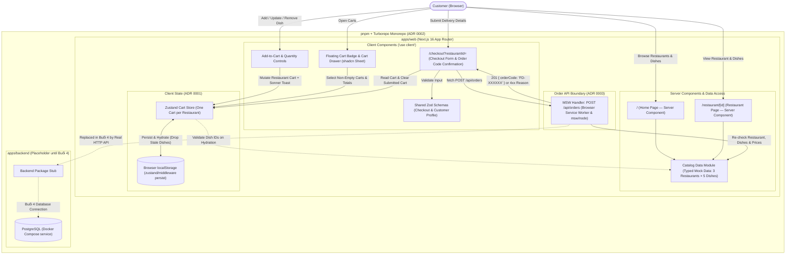

# Architecture (Buổi 1–3)

## System Overview Diagram

## 1. `pnpm` + Turborepo Monorepo (`apps/web`, `apps/backend`)

Per [ADR 0002](adr/0002-pnpm-not-bun.md), the repository is organized as a `pnpm` workspaces and Turborepo monorepo:

- **`apps/web`**: The Next.js 16 (App Router, TypeScript, Tailwind CSS, shadcn/ui) frontend application that serves **Customers** during Buổi 1–3.
- **`apps/backend`**: A workspace placeholder reserved for the real backend service in Buổi 4. Alongside it, `docker-compose.yml` runs two containers—`web` (the production Next.js build) and `postgres`—so the database environment is ready ahead of Buổi 4.
- **`scripts/check-repo.mjs` & CI workflows**: The course checker and Lighthouse CI workflow run alongside a dedicated Vitest + Playwright workflow.

## 2. Server and Client Component Split

`apps/web` defaults to React Server Components and restricts `"use client"` to interactive leaf components that read or mutate browser state:

| Layer | Components / Routes | Responsibility |
| :--- | :--- | :--- |
| **Server Components** | `app/layout.tsx`, Header, Footer, `app/page.tsx` (Home), `app/restaurant/[id]/page.tsx` (**Restaurant** detail) | Read **Restaurants** and **Dishes** through the catalog data-access module, format integer VND prices on the server, and call `notFound()` when a **Restaurant** slug does not exist. |
| **Client Components (`"use client"`)** | Add-to-**Cart** button, line quantity controls, floating **Cart** badge, **Cart** Drawer, `/checkout` form & confirmation view, MSW provider | Subscribe to the Zustand **Cart** store, trigger Sonner toasts on **Customer** actions, validate delivery fields with React Hook Form + Zod (reusing the shared rules across checkout and the **Customer Profile** schema), and submit **Orders** to `POST /api/orders`. |

## 3. Zustand Cart Store (One Cart per Restaurant, Persisted)

Per [ADR 0001](adr/0001-one-cart-per-restaurant.md), the **Cart** store is keyed by `restaurantId` so a **Customer** can build independent **Carts** across multiple **Restaurants** simultaneously:

- **Snapshot lines**: Each **Cart** stores line snapshots (`dishId`, `name`, `price`, `imageUrl`, `quantity`) belonging to that **Restaurant**.
- **Invariants**:
  - An empty **Cart** never remains in state; removing or decrementing the last **Dish** line deletes that **Restaurant**'s **Cart** entry.
  - Line `quantity` is bounded between `1` and `20`.
  - Every line's **Dish** must belong to the **Cart**'s **Restaurant**.
- **Public interface**:
  - *Actions*: add a **Dish**, increase quantity, decrease quantity (removes the line at `1`), remove a line, and clear a single **Restaurant**'s **Cart** (`clearCart`).
  - *Selectors*: list of non-empty **Carts**, lines for one **Cart**, subtotal for one **Cart**, total **Dish** quantity for one **Cart**, and total **Dish** quantity across all **Carts**.
- **LocalStorage persistence**: Wrapped in `persist()` from `zustand/middleware` with a versioned storage key. During hydration, any saved line whose `dishId` no longer exists in the catalog is dropped automatically.

## 4. MSW Order API (`POST /api/orders` in Every Environment)

Per [ADR 0003](adr/0003-msw-in-every-environment.md) (status: *proposed*), the **Order** endpoint is served by Mock Service Worker (MSW) across development, production (`next build && next start`), Vitest (`msw/node`), and Playwright:

- **Request contract**: `POST /api/orders` with `{ restaurantId, lines: [{ dishId, quantity, price }], customer: { fullName, phone, address, note? } }`.
- **Server-side verification in handler**: The handler never trusts the **Cart**'s price snapshot. It verifies that the **Restaurant** exists, every **Dish** belongs to that **Restaurant**, quantities and **Customer** fields are valid, and each submitted `price` matches the catalog's current integer VND price.
- **Responses**:
  - `201 Created`: Returns `{ orderCode }` (formatted as `FD-` plus 6 uppercase characters excluding `0`, `O`, `1`, `I`, e.g. `FD-7K3Q9P`) after a short delay so the `isSubmitting` spinner is observable. The UI then displays the **Order Code** confirmation and clears only that **Restaurant**'s **Cart**.
  - `4xx` rejection: Returns a machine-readable reason (`UNKNOWN_RESTAURANT`, `UNKNOWN_DISH`, `PRICE_CHANGED`, `INVALID_CUSTOMER`, `EMPTY_ORDER`) that the UI maps to a Vietnamese error message.
- **Buổi 4 transition**: Because the frontend and the Vitest contract tests talk exclusively to `POST /api/orders` over `fetch`, MSW can be swapped out for the real `apps/backend` service in Buổi 4 without changing the UI or contract test assertions.
